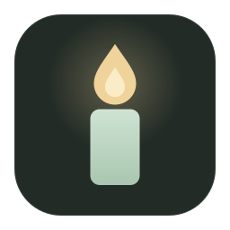
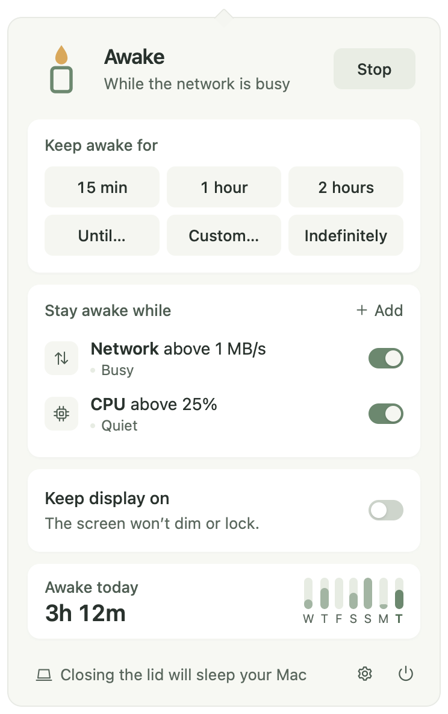
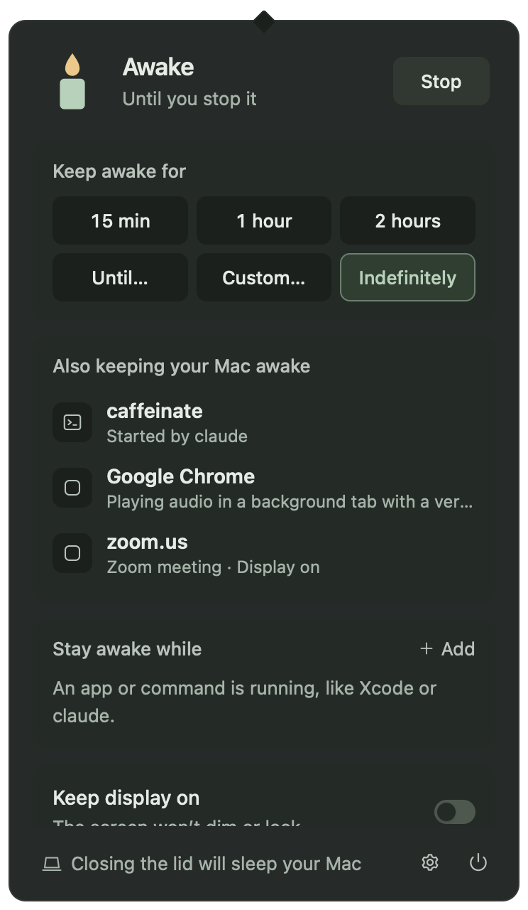
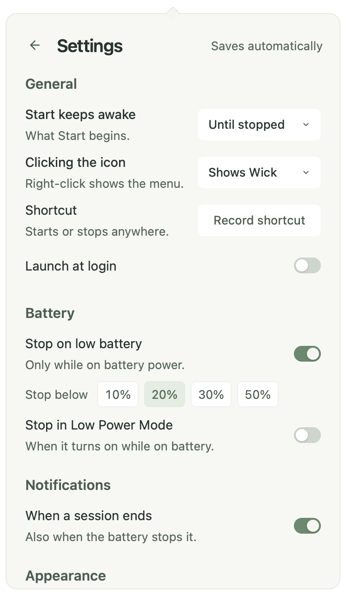

<p></p>

# Wick

**Keeps your Mac awake.** On demand, for a set time, or while an app or command is running. A quiet menu bar app for macOS, and a tray app for Windows.

[](https://github.com/Abulkosim/wick/actions/workflows/ci.yml)
[](https://github.com/Abulkosim/wick/releases/latest)
[](https://github.com/Abulkosim/wick/releases)
[](docs/install.md)
[](LICENSE)

[Download](https://github.com/Abulkosim/wick/releases/latest) · [Install](#install) · [What it does](#what-it-does) · [Privacy](#privacy) · [Changelog](CHANGELOG.md) · [Contributing](CONTRIBUTING.md)

<p>
  
  
</p>

- **One click.** Start until you stop it, or for 15 minutes, an hour, two hours, until a time, or any length. The menu bar candle burns down as the time runs out.
- **While something runs.** "Stay awake while **Xcode** is running", or **claude**, **codex**, **ffmpeg**, **xcodebuild**, or while the network or CPU is busy. Also on power, with an external display, or on a schedule.
- **Says what else is awake.** "caffeinate · Started by claude", "Google Chrome · Playing audio". No more `pmset -g assertions`.

## Install

Download **v0.5.0** from [GitHub Releases](https://github.com/Abulkosim/wick/releases/latest).

| Platform | Download |
| --- | --- |
| macOS 12+ · Apple Silicon and Intel | [Universal DMG](https://github.com/Abulkosim/wick/releases/download/v0.5.0/Wick_0.5.0_universal.dmg) |
| Windows 10/11 x64 | [Setup EXE](https://github.com/Abulkosim/wick/releases/download/v0.5.0/Wick_0.5.0_x64-setup.exe) · [MSI](https://github.com/Abulkosim/wick/releases/download/v0.5.0/Wick_0.5.0_x64_en-US.msi) |

**Homebrew** (macOS):

```sh
brew install --cask abulkosim/tap/wick
```

Builds are not signed with an Apple Developer ID or a Windows publisher certificate, so the first launch shows a warning.

**macOS.** Drag Wick to Applications and open it. When **“Wick” Not Opened** appears, click **Done**, then **System Settings → Privacy & Security → Open Anyway**. Wick lives in the menu bar, with no Dock icon.

**Windows.** Run the `-setup.exe`. On **Windows protected your PC**, click **More info → Run anyway**. Smart App Control blocks unsigned apps.

Step by step, updates and uninstall: [docs/install.md](docs/install.md).

Updates are signed and verified in the app. Wick checks once a day and installs only when you choose.

## What it does

| | |
| --- | --- |
| **Sessions** | Until stopped, 15 min, 1 hour, 2 hours, until a time (rolls to tomorrow), or a custom length up to 7 days. **Add 15 min** extends a running one. Time left stays right across sleep and in-app updates. |
| **Menu** | Right-click the candle for 15 minutes, 1 hour, 2 hours, until stopped, or Stop. |
| **Keys** | In the popover: 1, 2, 3 for the presets, 0 until stopped, S to start or stop, + to add 15 minutes. |
| **Display** | Keeps only the system awake by default. **Keep display on** also stops the screen from dimming and locking. |
| **Triggers** | Stay awake while an app or command runs, while the network or CPU is busy (until it's quiet for 2 minutes), on power, with an external display, or on a weekly schedule. Stop pauses a trigger until it ends. |
| **Also awake** | Lists other apps holding the Mac awake, with their reason, including audio playing through macOS and `caffeinate` started by a tool. |
| **Battery** | Stops below a level you choose (20% by default), and optionally in Low Power Mode. |
| **Screen lock** | Optionally pauses while the screen is locked and resumes on unlock (Mac). |
| **Lid** | Warns "Closing the lid will sleep your Mac" when that is true, and stays quiet in clamshell mode. |
| **Shortcut** | A global shortcut you record in Settings starts or stops from any app. |
| **History** | "Awake today 3h 12m" with a bar per day for the last week. Kept on this computer for 30 days; turn it off or clear it in Settings → History. |
| **Notifications** | "Session ended. Your Mac can sleep again." Only when Wick stops on its own. |
| **Automation** | `wick start`, `wick start 45`, `wick start 16:30`, `wick stop`, `wick toggle`, and `wick status` (JSON). Links: `wick://start?minutes=45`, `wick://start?until=16:30`, `wick://stop`, `wick://toggle`. |

<p>
  
</p>

## Why Wick

|  | Wick | [Amphetamine](https://apps.apple.com/app/amphetamine/id937984704) | [KeepingYouAwake](https://github.com/newmarcel/KeepingYouAwake) | `caffeinate` |
| --- | :-: | :-: | :-: | :-: |
| macOS | ✓ | ✓ | ✓ | ✓ |
| Windows | ✓ | – | – | – |
| One-click start and timed sessions | ✓ | ✓ | ✓ | – |
| Until a set time | ✓ | ✓ | – | – |
| While an app runs | ✓ | ✓ | – | – |
| On power or with an external display | ✓ | ✓ | display only | – |
| While a command-line tool runs (`claude`, `ffmpeg`) | ✓ | – | – | `-w pid` |
| Shows what else keeps the Mac awake | ✓ | – | – | – |
| Battery guard | ✓ | ✓ | ✓ | – |
| Global shortcut | ✓ | ✓ | – | – |
| Closed lid without an external display | – | ✓ (admin script) | – | – |
| Open source, free | ✓ | – | ✓ | ✓ |

Wick has no closed-lid mode on purpose. Keeping a closed Mac awake without an external display needs root and a persistent `pmset` change, and a forgotten session overheats a Mac in a bag. Wick tells you when closing the lid will sleep the Mac instead.

## Shortcuts, Raycast and scripts

The app's binary doubles as a command line tool. Homebrew links it as `wick`; otherwise:

```sh
alias wick=/Applications/Wick.app/Contents/MacOS/wick
wick start 45          # 45 minutes
wick start 16:30       # until 16:30
wick toggle
wick status            # {"running":true,"awake":true,"session":{"mode":"for",…},"endsAt":…,"awakeTodayMinutes":192}
```

In Shortcuts, use **Open URLs** with `wick://start?minutes=60`, `wick://start?until=18:00`, `wick://stop` or `wick://toggle`. Alfred can open the same links.

**Raycast:** the [Wick extension](raycast/) (Keep Awake, Toggle Keep Awake, Keep Awake for, Stop Keeping Awake) shows the current state and today's time awake, and starts a session for any number of minutes or until a time.

## How it works

Wick holds a standard power assertion, `PreventUserIdleSystemSleep`, or `PreventUserIdleDisplaySleep` with **Keep display on**. You can see it in `pmset -g assertions` as `Wick: awake until 16:30`. macOS ties the assertion to Wick's process, so quitting or a crash releases it. Wick never changes system settings.

## Privacy

No account, no telemetry, no analytics. The only network request is the daily update check against GitHub Releases, which sends nothing about you. Settings and history stay in `~/Library/Application Support/com.abulkosim.wick/`. Details: [PRIVACY.md](PRIVACY.md). Vulnerabilities: [SECURITY.md](SECURITY.md).

## Develop

Run from source, preview every state in a browser, and run the tests: [CONTRIBUTING.md](CONTRIBUTING.md). Wick's design follows its sibling, [Margin](https://github.com/Abulkosim/margin).

## License

[MIT](LICENSE)
